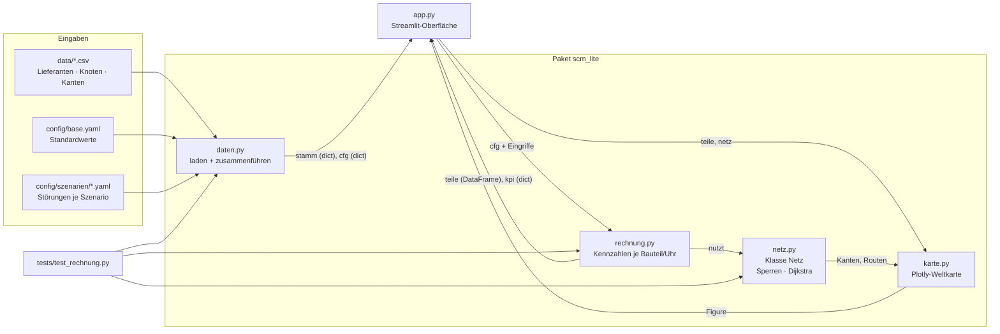
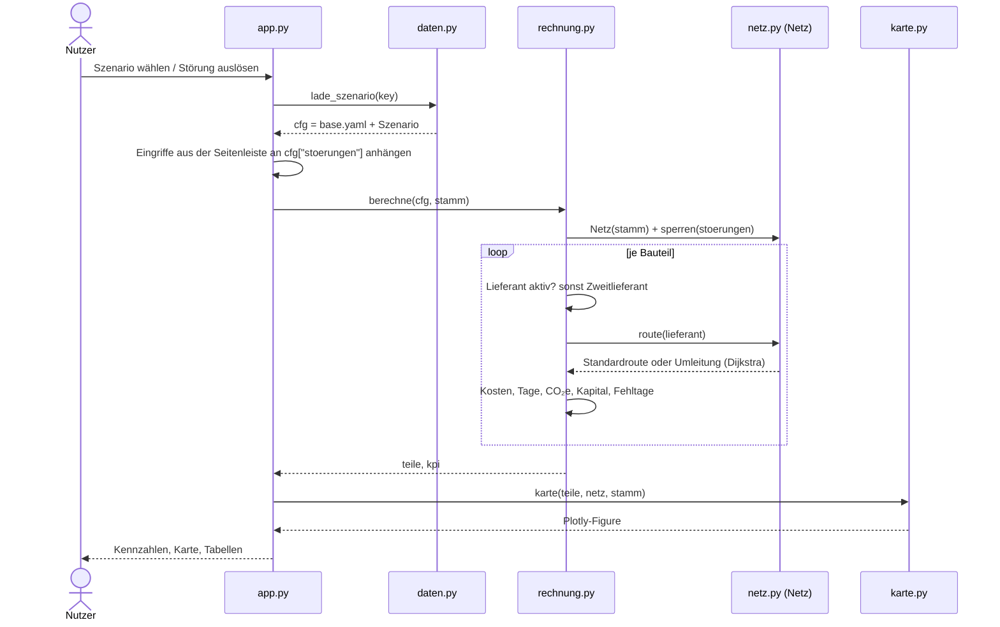
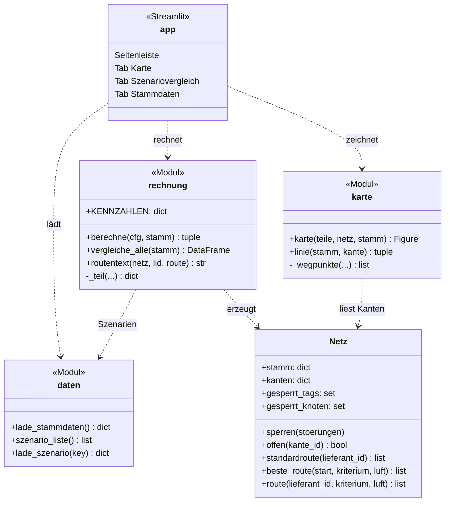
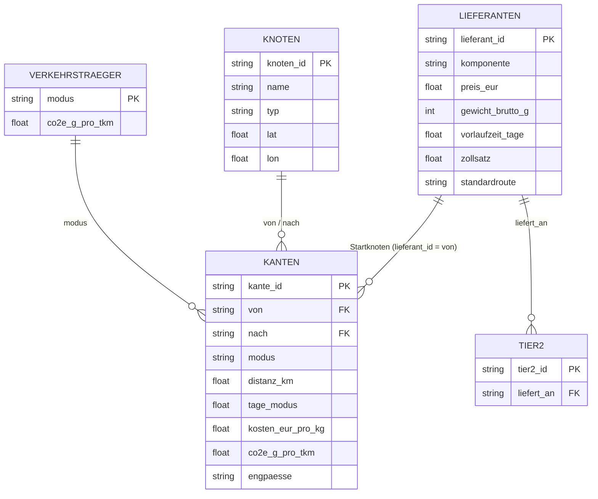

# Architektur der einfachen Version

Die Diagramme sind in Mermaid geschrieben. GitHub/GitLab zeigen sie direkt an. In VS Code
braucht die Markdown-Vorschau die Erweiterung *Markdown Preview Mermaid Support*.

## 1. Welche Datei greift auf was zu

## 2. Was passiert bei einem Klick in der Oberfläche

## 3. Klassen und Funktionen

## 4. Datenmodell (CSV-Dateien)

## 5. Wichtige Datenstrukturen zwischen den Dateien

| Name | Typ | Erzeugt in | Inhalt |
|---|---|---|---|
| `stamm` | dict aus DataFrames | `daten.lade_stammdaten` | `lieferanten`, `knoten`, `kanten` |
| `cfg` | dict | `daten.lade_szenario` | base.yaml + Szenario, z. B. `lieferanten`, `stoerungen`, `sicherheitstage` |
| `stoerungen` | Liste von dicts | YAML / Seitenleiste | `{typ, ziel, dauer_tage}` |
| `teile` | DataFrame | `rechnung.berechne` | eine Zeile je Bauteil: Lieferant, Route, Kosten, Tage, CO₂e, Fehltage |
| `kpi` | dict | `rechnung.berechne` | 6 Kennzahlen je Uhr |
