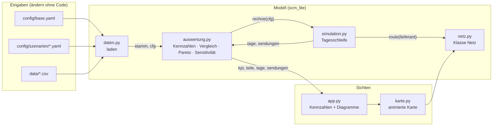
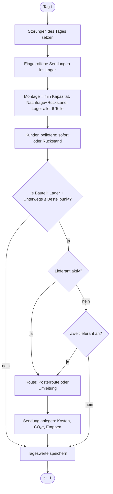
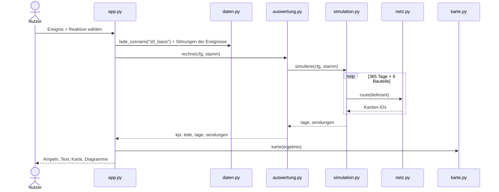
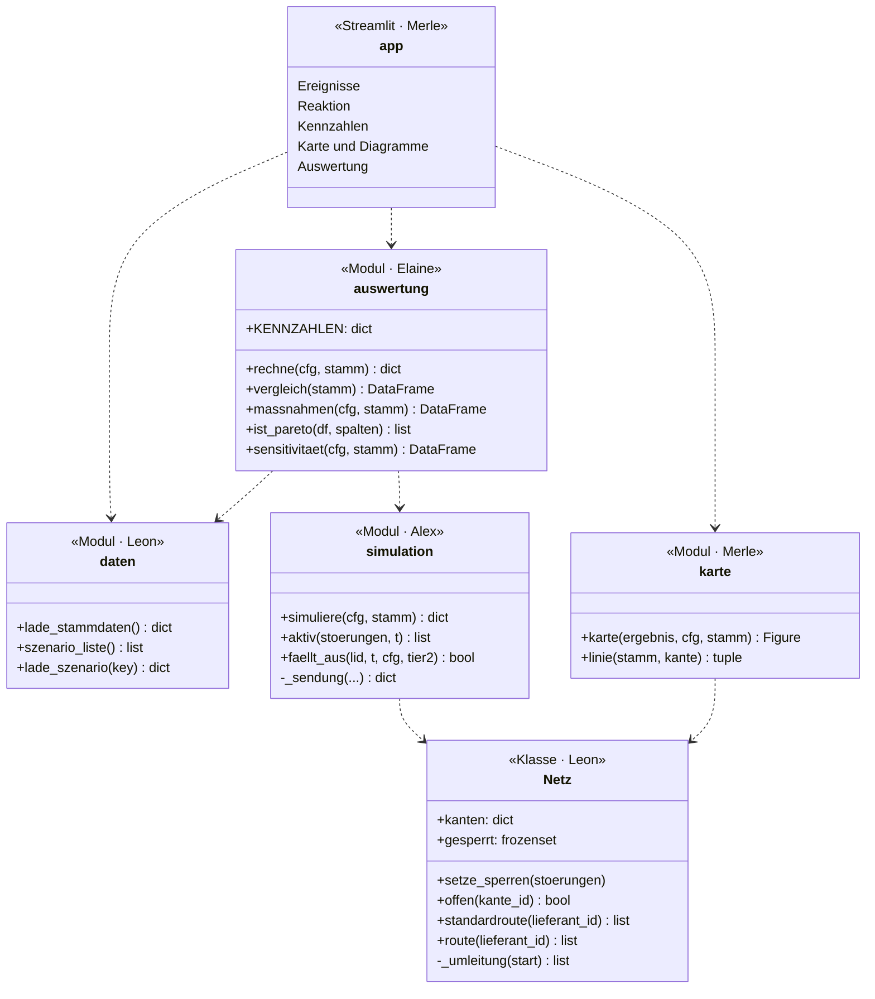
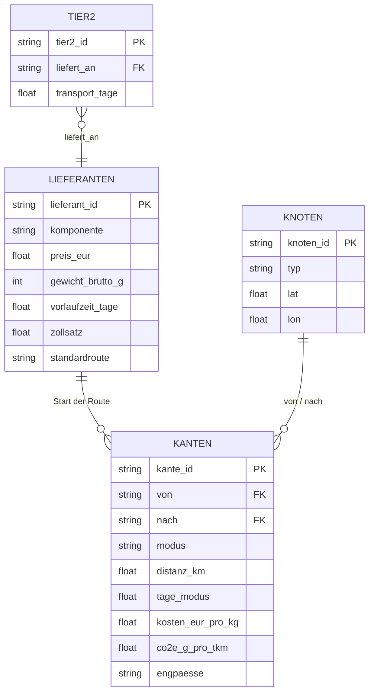

# Architektur

Die Diagramme sind in Mermaid geschrieben. GitHub zeigt sie direkt an. In VS Code braucht die
Vorschau (Strg+Shift+V) die Erweiterung *Markdown Preview Mermaid Support*.

## 1. Schichten und Datenfluss

Alle drei Sichten lesen dasselbe Ergebnis von `auswertung.rechne()`. Deshalb passen Karte,
Diagramme und Kennzahlen immer zueinander.

## 2. Tagesschleife (`simulation.simuliere`)

## 3. Ablauf bei einem Klick

## 4. Klassen und Funktionen

## 5. Datenmodell

## 6. Schnittstellen zwischen den Modulen

| Objekt | Typ | erzeugt von | Inhalt |
|---|---|---|---|
| `stamm` | dict aus DataFrames | `daten.lade_stammdaten()` | `lieferanten`, `tier2`, `knoten`, `kanten` |
| `cfg` | dict | `daten.lade_szenario()` | Inhalt von base.yaml + `stoerungen` (Liste von `{typ, ziel, start_tag, dauer_tage}`) |
| `tage` | DataFrame | `simulation.simuliere()` | je Tag: `nachfrage, montage, sofort, rueckstand, lager_<teil>, unterwegs_<teil>` |
| `sendungen` | DataFrame | `simulation.simuliere()` | je Bestellung: `bauteil, lieferant, bestellt, ankunft, menge, kosten_stk, co2_g_stk, umgeleitet, etappen` |
| `kpi` | dict | `auswertung.rechne()` | 5 Kennzahlen (Schlüssel wie in `KENNZAHLEN`) |
| `teile` | DataFrame | `auswertung.rechne()` | je Bauteil: `lieferant, bestellungen, kosten_stk, lieferzeit, co2_g_stk, status` |
