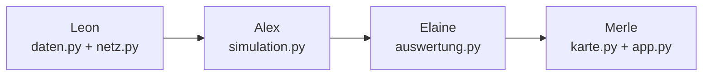

# Aufteilung: Wer programmiert was?

Der Code im Repo ist ein **KI-Referenzentwurf**. Jede Person programmiert ihr Modul selbst
nach. Die Referenz dient dabei als Vorlage und Testmaßstab. Erst danach dürfen die Dateien
das Kennzeichen **E** tragen.

## Kennzeichnung (Aufgabenstellung 6.2)

| Kennzeichen | Bedeutung | Wann verwenden |
|---|---|---|
| **E** | eigenständig entwickelt | eigenes Modul, selbst nachprogrammiert |
| **G** | gemeinsam in der Gruppe | Konfiguration, Datenauswahl, Schnittstellen, Szenarien |
| **KI** | durch KI erzeugt oder wesentlich überarbeitet | Teile, die unverändert aus der Referenz übernommen werden; Prompt in `prompts/` |
| **F** | fremd | pandas, networkx, plotly, streamlit, pyyaml |

**Im Dateikopf** steht z. B.:

```python
"""Tagesschleife …

Kennzeichen: E | Autor: Alex
Übernommen aus KI-Referenz: _sendung() (KI, Prompt prompts/alex_01.md)
"""
```

Bei gemischter Entstehung schreibt man den eigenen Anteil konkret dazu, auf Funktionsebene.

---

## Zuordnung

### Leon – Daten und Netz

| Datei | Inhalt | Kennzeichen nach Nachprogrammierung |
|---|---|---|
| `data/lieferanten.csv`, `tier2.csv`, `knoten.csv`, `kanten.csv` | Daten pflegen, Quellen ergänzen | G (Auswahl) + E (Recherche je Poster) |
| `config/base.yaml`, `config/szenarien/*.yaml` | Standardwerte, Szenarien | G |
| `scm_lite/daten.py` | `lade_stammdaten()`, `szenario_liste()`, `lade_szenario(key)` | E |
| `scm_lite/netz.py` | Klasse `Netz`: `setze_sperren`, `offen`, `standardroute`, `route`, `_umleitung` (Dijkstra) | E |
| Test | `test_suez_sperre_fuehrt_ueber_kap` | E |

**Liefert:** `stamm` (dict aus DataFrames), `cfg` (dict) und die Klasse `Netz`.

### Alex – Simulation

| Datei | Inhalt | Kennzeichen |
|---|---|---|
| `scm_lite/simulation.py` | `aktiv`, `faellt_aus` (inkl. Tier-2-Puffer), `simuliere` (Tagesschleife), `_sendung` | E |
| Tests | `test_mindestanforderungen`, `test_handrechnung_saphirglas`, `test_tier2_ausfall_wirkt_erst_nach_puffer` | E |

**Braucht:** `stamm`, `cfg`, `Netz` von Leon. Bis dahin reicht die Referenz.
**Liefert:** dict mit `tage` und `sendungen` (Spalten siehe ARCHITEKTUR.md, Abschnitt 6) sowie `ausfall_tage` und `kein_weg`.

### Elaine – Auswertung

| Datei | Inhalt | Kennzeichen |
|---|---|---|
| `scm_lite/auswertung.py` | `KENNZAHLEN`, `rechne` (5 Kennzahlen + Bauteiltabelle), `vergleich`, `massnahmen`, `ist_pareto`, `sensitivitaet` | E |
| Tests | `test_basis_voll_lieferfaehig`, `test_ausfall_und_gegenmassnahmen`, `test_pareto` | E |

**Braucht:** `simuliere()` von Alex.
**Liefert:** `kpi`, `teile` und die Tabellen für Vergleich, Pareto und Sensitivität.

### Merle – Oberfläche und Karte

| Datei | Inhalt | Kennzeichen |
|---|---|---|
| `scm_lite/karte.py` | `linie` (Seewege mit Wegpunkten), `_punkt` (Interpolation), `karte` (Routen, Tier-2, Distribution, Frames je Woche) | E |
| `app.py` | Ereignis-Knöpfe, Reaktionen, Ampel-Kennzahlen, Diagramme, Aufklapper Auswertung | E |
| Doku | Screenshots der drei Sichten für alle | E |

**Braucht:** `rechne()` und die Auswertungsfunktionen von Elaine.

### Gemeinsam

| Was | Kennzeichen |
|---|---|
| `README.md`, `docs/`, Schnittstellen (Spaltennamen, Funktionsnamen) | G |
| Abschlusspräsentation | G |

---

## Reihenfolge zum Nachprogrammieren



Alle können **sofort parallel** anfangen. Wer auf ein Modul wartet, nutzt so lange die
Referenzversion. Die Funktionsnamen und Rückgabewerte (Schnittstellen) bleiben gleich, dann
passt am Ende alles zusammen.

**Ablauf je Person:**

1. Eigenen Branch anlegen: `git checkout -b feat/<modul>-<name>`.
2. Die eigene Datei leeren und Funktion für Funktion selbst neu schreiben. Die Referenz nur zum Vergleichen öffnen.
3. Nach jeder Funktion `python -m pytest` laufen lassen. Die Tests zeigen, ob das Verhalten noch stimmt.
4. Kopfzeile auf **E** setzen. Übernommene Stellen als **KI** markieren.
5. Pull Request stellen, eine andere Person reviewt, dann Merge in `main`.
6. Commits mit Präfix `[E]`, `[G]` oder `[KI]`. Die Commit-Historie dient als Nachweis.

## Umfang je Person (Richtwert)

| Person | Zeilen Code (Referenz) | Schwerpunkt im Programmentwurf |
|---|---|---|
| Leon | ≈ 100 + Daten | Datenmodell, Graph, Dijkstra, Konfigurationsmechanismus |
| Alex | ≈ 105 | Simulationsablauf, Bestellpolitik, Tier-2-Logik, Verifikation |
| Elaine | ≈ 95 | Kennzahlen, Zielkonflikte, Pareto, Sensitivität |
| Merle | ≈ 235 | drei Sichten, Animation, Bedienkonzept |
